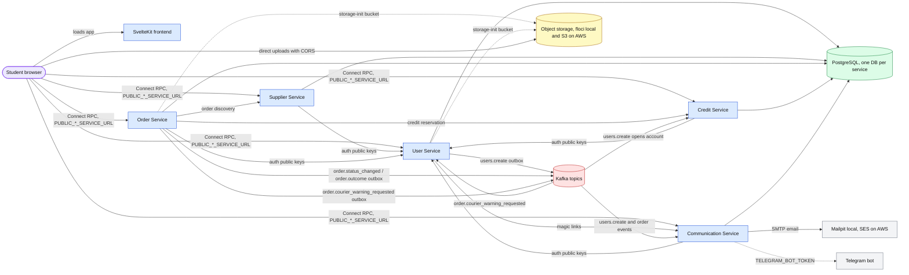
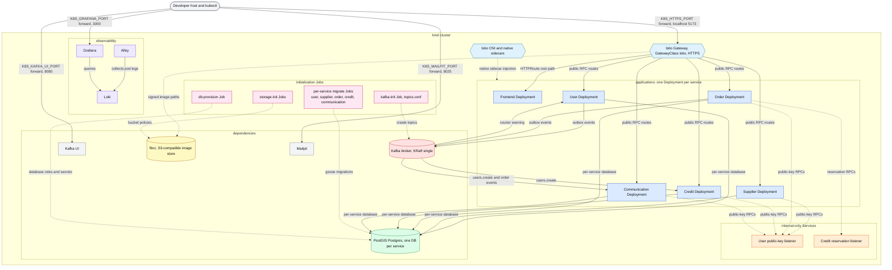
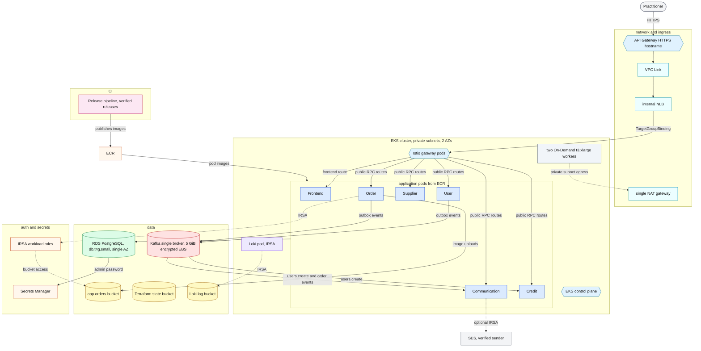

# CS3219 — Software Design and Architecture (AY2627 Sem 1)

## Friend on Campus (FoC)

**Friend on Campus (FoC)** is a peer-to-peer campus errand platform where
students can request items to be collected from stores or facilities on
campus, and other students can fulfil (and deliver) those requests. The
platform runs on a closed credit economy — credits cannot be bought,
withdrawn, or exchanged for money, and only circulate within the platform.

The backend is a set of Go microservices that expose Connect RPC APIs
defined under `proto/` and react to each other's domain events published to
Kafka (schemas under `kafka/`). Data lives in PostgreSQL, the frontend is a
SvelteKit application, and the repo also contains the protobuf contracts,
SQL schema and build/deploy glue for all services.

---

## System Architecture

The SvelteKit frontend calls each Go service's public Connect RPC listener
straight from the browser through `PUBLIC_*_SERVICE_URL` endpoints. Services
authenticate each other against User's public keys and coordinate through
Kafka events published from transactional outboxes; one Postgres database per
service, S3-compatible object storage, and email and Telegram transports
complete the picture.



---

## Team Members

| Name | Role |
| ----- | ----- |
| Andrew | Supplier & Order Services, AWS production tooling |
| Hon Yi Hao | Supplier & Order Services, shared packages, Kafka infrastructure, frontend, observability; cross-service code review |
| Kevin | Communication Service, Order contracts, Frontend scaffold |
| Florian Viorel Tanely | User Service, Frontend authentication, Kubernetes bootstrap |
| XKMai | Credit Service, User Service persistence and magic-link auth |

---

## Repository Structure

This repository follows a **one-service-per-folder** structure: each
microservice lives in its own top-level folder. Shared Go HTTP utilities
live in the `pkg` module (`api` and `middleware`), and each service module
refers to the shared module as `../pkg`. Compose mounts each service at
`/app` and the shared package at `/pkg`, so the same relative path works
inside the containers, and builds resolve across the modules through the
`go.work` workspace. Each service composes its dependencies and configures
the default `slog` logger at startup.

```text
.
├── user-service/            # accounts, authentication, admin roles
├── supplier-service/        # store and goods discovery, locations
├── order-service/           # errand orders, offers, delivery workflow
├── credit-service/          # closed credit economy and reservation holds
├── communication-service/   # chat, email and Telegram notifications
├── moderation-service/      # reports, appeals and moderation outcomes
├── frontend/                # SvelteKit web application
├── pkg/                     # shared Go modules (api, auth, kafka, gen, ...)
├── proto/                   # Connect RPC API contracts (Buf)
├── kafka/                   # Kafka event contracts (Buf), see kafka/README.md
├── infra/                   # Kafka topic provisioning, Kubernetes, AWS (Terraform)
├── docker/                  # Compose helpers (Postgres init script, k8s images)
├── scripts/                 # agents' tooling (seeding, k8s helpers, AWS release)
├── data/                    # assignment resources and seed data
├── docs/                    # ADRs, runbooks, plans, testing notes
└── README.md
```

- Any **nice-to-have (N2H)** feature that warrants its own service should
  be added as an **additional folder** at the same level, following the
  same per-service structure.
- Files for agentic coding tools (e.g. agent configs, prompts, skills)
  may be added as needed, but must still **respect the
  one-service-per-folder skeleton** for core implementation.
- `frontend/` is the SvelteKit web application; see its README for local
  development instructions.
- API contracts are protobuf files under `proto/<service>/v1`; after
  changing a contract run `make buf-lint` and `make buf-generate` (generated
  Go code lands in `pkg/gen`, TypeScript in
  `frontend/src/lib/gen`). Kafka event contracts follow the same pattern
  under `kafka/<service>/events/v1` and generate into `pkg/kafkagen`.

---

## Local Dev Setup

Prerequisites: `docker` with the `docker-compose` plugin.

### Services and ports

Compose starts the full stack:

| Component | Local URL | Port env var |
| ----- | ----- | ----- |
| Frontend (SvelteKit/Vite) | http://localhost:5173 | `FRONTEND_PORT` |
| User Service (`user-service`) | http://localhost:8081 | `USER_PORT` |
| Supplier Service (`supplier-service`) | http://localhost:8082 | `SUPPLIER_PORT` |
| Order Service (`order-service`) | http://localhost:8083 | `ORDER_PORT` |
| Communication Service (`communication-service`) | http://localhost:8084 | `COMMUNICATION_PORT` |
| Credit Service (`credit-service`) | http://localhost:8085 | `CREDIT_PORT` |
| Postgres (one DB per service) | `localhost:5432` (`user_dev`, `supplier_dev`, `order_dev`, `credit_dev`, `communication_dev`) | `POSTGRES_PORT` |
| Kafka broker (KRaft) | `localhost:9092` | `KAFKA_PORT` |
| Kafka UI (Kafbat) | http://localhost:8080 | `KAFKA_UI_PORT` |
| floci (local S3 for image uploads) | `localhost:4566` | `FLOCI_PORT` |
| Mailpit (outgoing mail catch-all) | http://localhost:8025 | `MAILPIT_UI_PORT` |

The shared Postgres image is `postgis/postgis:18-3.6`, so it also serves the
PostGIS extension used by Supplier's location features. Outgoing email is
caught by Mailpit (read magic links at http://localhost:8025) and the
Telegram bot is optional (`TELEGRAM_BOT_TOKEN` in `.env`); the
Communication Service runs with Telegram disabled without a token.

### Running the stack

1. Configure env:
   ```bash
   cp .env.example .env
   # fill POSTGRES_PASSWORD and matching USER_DATABASE_URL and SUPPLIER_DATABASE_URL
   ```

2. Start infra + services (Go services apply their migrations on startup):
   ```bash
   docker compose up --build
   ```

   On first run `kafka-init` creates every topic declared in
   `infra/kafka/topics.conf` before the services that publish or consume
   events start, `order-storage-init` and `user-storage-init` provision the
   two bucket policies in floci, and `postgres` creates the five dev
   databases from `docker/postgres/init-dbs.sh`. Go services apply their
   migrations on startup; Air live-reloads source changes and Vite reloads
   the frontend (npm dependencies are installed from the lockfile when the
   frontend starts). This is the complete Compose setup — no separate
   migration command is needed; after adding a migration, restart the
   affected service to apply it.

   To run just one service with its dependencies:
   ```bash
   docker compose up --build user-service          # adds Postgres, Kafka topics, storage init, ...
   docker compose up --build communication-service # adds Mailpit and Kafka topics
   ```

### Upgrading an existing Compose setup

The User Service listener split requires a one-time change to existing
`.env` files. Older `.env` files set
`USER_SERVICE_BASE_URL=http://user-service:8080`. Inside the Compose
network, User's port **8080** serves public APIs; port **8081** is User
Service's *internal* listener (published only inside the Compose network,
not to the host) and serves public-key retrieval, so
`USER_SERVICE_BASE_URL` must point at the internal listener:

```dotenv
USER_SERVICE_BASE_URL=http://user-service:8081
```

`USER_PORT` (8081 on the host) is the separate host-side mapping for
public APIs; do not use it for service-to-service calls. With the old
value, Supplier, Order, Credit and Communication cannot fetch public keys
and fail authentication startup after retrying. Updating `.env.example`
does not update your existing `.env`, and its explicit value overrides
Compose's new default. If Compose keeps recreating the old value, delete
the line from `.env` so the default from `compose.yaml` wins. After
editing `.env`, run:

```sh
docker compose up -d user-service supplier-service order-service credit-service communication-service moderation-service
```

Use `up` so Compose recreates containers with the updated environment;
`docker compose restart` alone does not apply it. Keep existing
credentials and database volumes. See the
[listener migration landmine](LANDMINES/compose-user-internal-listener.md)
for diagnosis.

Tear down (containers + images + DB data):
```bash
docker compose down -v --rmi all
```

---

## Kubernetes Deployment (Optional)

For the configurable AWS load and fault-test tools, see the
[performance and resilience runbook](docs/testing/aws-performance.md).

Besides Docker Compose, the full stack can run on a local Kubernetes cluster
(kind) with an Istio service mesh. Compose remains the default for
development; the two stacks share default host ports, so run only one at a
time.

```bash
cp .env.example .env
K8S_BOOTSTRAP_SUPERADMIN_EMAIL=admin@example.test make k8s-up
```

The first run creates the local `kind` cluster, installs Istio and the Gateway
API, builds and deploys every service, and serves the app at
`https://localhost:5173` (self-signed local certificate). Prerequisites,
day-to-day commands (`make k8s-status` / `k8s-smoke` / `k8s-deploy`), and
teardown are documented in [`infra/k8s/README.md`](infra/k8s/README.md).
Operations, security boundaries, and production guidance live in
[`docs/runbooks/kubernetes.md`](docs/runbooks/kubernetes.md); the design
decision is recorded in
[`docs/adr/kubernetes-istio.md`](docs/adr/kubernetes-istio.md).

The local cluster packs one Deployment per application and every platform
dependency into a single `kind` cluster. Each Go service keeps its
deployment-agnostic listener split (`PORT` public, `INTERNAL_PORT`
internal): the Istio Gateway routes only the public Services, while User's
public-key listener and Credit's reservation listener stay internal-only.
Initialization Jobs run in a separate stage before the applications start,
and the developer reaches the stack through port-forwards only.



---

## AWS Production Deployment (Optional)

The production environment is defined in Terraform under `infra/aws`; its
README covers prerequisites, state and planning. The release pipeline and
day-to-day rollout/verification steps are documented in
[`docs/runbooks/aws-releases.md`](docs/runbooks/aws-releases.md) and
[`docs/adr/aws-release-configuration.md`](docs/adr/aws-release-configuration.md).

Terraform under `infra/aws` provisions the demo topology below: API Gateway
and a VPC Link in front of an internal NLB and Istio gateway pods, an EKS
cluster with two On-Demand `t3.xlarge` workers in private subnets across two
AZs behind a single NAT gateway, single-AZ data stores, and IRSA workload
roles instead of static AWS access keys.



---

## Docs and Glossary

- Architecture decisions and their rationale: `docs/adr/`
- Operational runbooks: `docs/runbooks/`
- Project glossary: [`glossary.md`](glossary.md)
- Non-obvious failure notes (update when a problem bites): `LANDMINES/`

---

## AI Use Summary
This project is done with AI assistance.

**Tools:** AI coding assistants (chat-based and agentic coding
tools such as Opencode, Codex using models such as DeepSeek and GPT 6.1).

**Prohibited phases avoided:** requirements elicitation and prioritization;
architecture and design decisions (component boundaries, design patterns,
data schemas, interfaces); and drafting of decision rationales.

**Used for:**

- Learning support to understand and compare candidate tools, technologies,
  architectures, and design approaches, and to evaluate the trade-offs
  between them. All final decisions, their rationale, and the records in
  `docs/adr/` were made, written, and validated by the team.
- Generating scaffolding and boilerplate when creating a new service (folder
  structure, configuration, build and container definitions, generated-code
  stubs).
- Writing implementation code (functions, classes, unit tests) after the
  team finalized the relevant requirements and design.
- Debugging assistance (error explanations, test suggestions) and
  refactoring and documentation improvements (docstrings, comments, README
  content).

**Verification:** All AI outputs were reviewed, tested, verified, and edited
  as necessary by the team.
