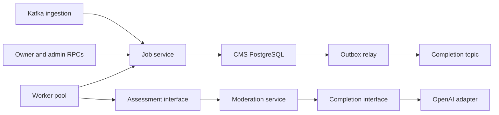
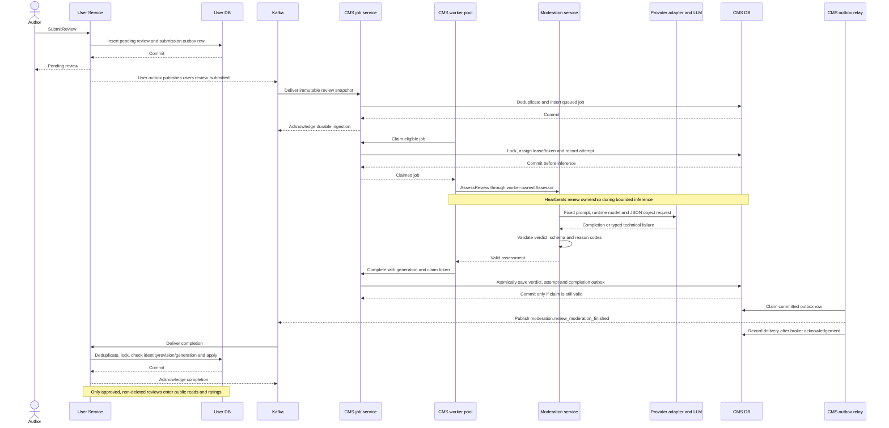
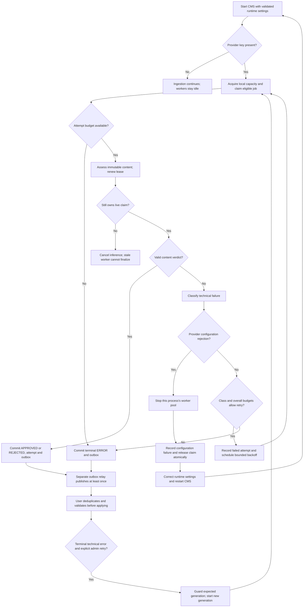

# ADR: Review content moderation

Date: 10 Nov 2026
Status: implemented for #264

## Decision

Content Moderation Service (CMS) asynchronously assesses submitted review text.
User Service owns review rows, publication, ratings and removal. Services
communicate through Kafka events; CMS never writes User's database.

Assessment settings belong to the running process. `CMS_LLM_MODEL_ID` selects
one model at startup. Provider URL and credentials are deployment settings.
The rubric, reason codes, response schema and JSON object output mode are
compiled into the service. Changing settings requires restarting CMS; changing
the rubric requires deploying new code. There are no drafts, configuration
versions, activation APIs, model discovery or configuration seeds.

## Responsibilities and dependencies

- `internal/moderation`: assess immutable review content, construct the fixed
  prompt and validate the provider's response. Its `CompletionClient` interface
  owns the provider request and response types.
- `internal/job`: ingestion, deduplication, queries, leases, retries, worker
  scheduling and transactional completion. The worker defines the assessment
  interface it consumes. It imports moderation's assessment types, while
  moderation has no dependency on job execution or persistence.
- `internal/openaiadapter`: implement the completion interface and translate
  provider failures. Provider SDK types stay inside this adapter.
- `internal/rpc/review`: authenticate and authorize owner/admin requests,
  translate domain values, and expose job inspection and manual retry.
- `internal/outbox`: deliver committed completion events to Kafka.
- `cmd/server`: construct dependencies once and own process lifecycle.

The assessor receives content, not a database job or configuration version.
Jobs never select settings. An attempt after restart uses the new process's
settings. Model IDs in attempt history and policy versions on results are
historical metadata; they do not control future execution.

## Reliability and failures

Ingestion deduplicates on the moderation request identity and quarantines
conflicting or malformed input. Claims use row locks, bounded leases,
heartbeats and claim tokens. Database transactions finish before inference.
Terminal writes atomically save the verdict, attempt and outbox event and
reject stale claims. Writers lock jobs before attempts. Lease validity is
checked after acquiring the row lock using the database clock.

Worker concurrency is bounded per process. Shutdown cancels inference and
uses bounded detached cleanup to release claims. Crash recovery uses lease
expiry. Normal technical failures retry with bounded backoff and an attempt
limit; invalid output and provider filtering have smaller bounded budgets.
No provider failure implies approval or content rejection.

A provider configuration rejection stops assessment workers in that process
and releases the affected claim. Operators correct settings and restart.
Other replicas independently stop if their settings are rejected. The failed
call remains in attempt history; repeated broken restarts can exhaust a job's
budget, after which an admin can retry it. Missing credentials leave workers
idle while ingestion continues. Health checks report database health and do
not prove that inference is available; operational logs report worker faults.

Outbox delivery is at least once. Event IDs remain stable on redelivery.
User deduplicates events and verifies request identity, revision and generation
before applying a verdict. Approved and rejected verdicts are final. A later
explicit retry may replace a technical error. Technical diagnostics and
credentials never enter owner responses or completion events.

## API and publication

Owners may query bounded job summaries for their review requests. Admins may
inspect attempts and retry terminal errors with an expected generation guard.
Manual retry starts a new generation using the running assessor.

User's unpublished review projection remains canonical. Its paginated list
includes pending, rejected and moderation-error reviews together, with no
status or order filters. Missing CMS jobs mean
not yet ingested, never approval. Frontend services do not cache review lists;
mounted pages own their state and ignore stale requests.

## End-to-end submission and completion

Submission returns after User commits the pending review and its outbox row;
it does not wait for Kafka or inference. CMS acknowledges only after durable
ingestion. The worker and outbox relay run independently: workers commit
results, and the relay publishes committed events outside database transactions.

A rejection follows the same completion path and remains unpublished. A
terminal technical failure emits `ERROR`; no technical failure implies a
content verdict. The relay can redeliver after a crash between publication and
acknowledgement, using the original event ID.

## Execution and retry decisions

`moderation.Classify` maps adapter and response-validation errors to stable
classes. Job execution owns retry budgets and scheduling; the adapter owns
SDK/HTTP translation. Provider refusal and content filtering mean failure to
assess, never evidence that the review violates policy.

| Failure | Stored class | Job handling |
| --- | --- | --- |
| Empty, malformed, truncated or schema-invalid response | `invalid_output` | Two attempts by default, within the overall limit, then terminal `ERROR`. |
| Provider refusal or filtered completion | `content_filter` | Two attempts by default, within the overall limit, then terminal `ERROR`. |
| HTTP 429 | `rate_limited` | Honor `Retry-After` up to the maximum delay; otherwise use jittered backoff. |
| Request deadline | `timeout` | Durable bounded retry with jittered backoff. |
| Network failure / HTTP 5xx | `connection` | Durable bounded retry with jittered backoff. |
| Unrecognized assessment error | `server_error` | Durable bounded retry with jittered backoff. |
| Rejected credentials, model or request settings | `configuration` | Record failure while releasing the claim; stop this process's workers until restart. |
| Cancellation or lost claim | No content verdict | Bounded release when still owned, or leave recovery to the valid owner/lease machinery. |

The overall limit defaults to five attempts per generation. Crash recovery and
shutdown releases consume that budget. A configuration rejection also consumes
its claimed attempt: repeated broken restarts can exhaust the job. There is no
durable configuration pause and no automatic new generation on restart.

## Event and publication contracts

| Topic | Producer and durable boundary | Consumer checks |
| --- | --- | --- |
| `users.review_submitted` | User inserts the review and outbox in one transaction. Event carries stable IDs, authenticated reviewer, revision and complete immutable comment. | CMS validates content and identity, deduplicates by moderation request, and quarantines conflicting or invalid decoded input. |
| `moderation.review_moderation_finished` | CMS saves terminal job, attempt and outbox in one fenced transaction. Outcomes are `APPROVED`, `REJECTED` or `ERROR`. | User deduplicates by event ID and checks reviewer, request, revision and generation before changing publication. |

Wire-decode failures stop the subscriber; its typed handler cannot quarantine
bytes that never decoded. Database failures are returned for redelivery.
Approved/rejected verdicts are final in User; only a technical error can be
replaced through a later explicit retry. Admin removal remains separate:
approval cannot clear `deleted_at` or bypass removal. All public review reads,
counts and rating statistics require approval and exclude deleted reviews.

Both services store reason codes as native PostgreSQL text arrays.

## Data exposure

The provider adapter returns only service-owned completion data; SDK types,
credentials, raw provider error bodies and provider request IDs stay outside
API contracts. Attempt details store sanitized classes rather than wrapped
provider diagnostics. Admin inspection exposes attempt classes and model
history; owner summaries omit technical error classes. Completion events carry
content reason codes only for rejection and never provider diagnostics.
User exposes `moderation_error` when no verdict was obtained.

## Alternatives considered

- Synchronous inference in User's submission path would couple submission
  latency and availability to the provider.
- An in-memory queue would lose work on restart; a shared database would break
  service ownership. Durable jobs and separate transactional outboxes preserve
  independent failure recovery.
- A generic LLM framework or an interface for every persistence operation adds
  abstraction without another consumer. Keep the completion port and worker
  assessment port narrow, with concrete colocated job persistence.
- A distributed concurrency semaphore adds cluster state. Per-process capacity
  and explicit replica count are sufficient; duplicate inference after a crash
  remains possible.

## Consequences

Configuration changes require an operational restart, and retries can use a
different model after restart. This removes configuration lifecycle and recovery
machinery while keeping reliable asynchronous processing and job diagnosis.
