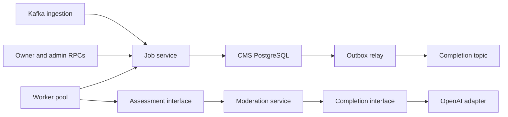

# ADR: Review content moderation

Date: 10 Nov 2026
Status: implemented for #264

## Decision

Content Moderation Service (CMS) asynchronously assesses submitted review text.
User Service owns review rows, publication, ratings and removal. Services
communicate through Kafka events; CMS never writes User's database.

Assessment settings belong to the running process. `CMS_LLM_MODEL_ID` selects
one model at startup. Provider URL and credentials are deployment settings.
The rubric, reason codes, response schema and JSON object output mode are
compiled into the service. Changing settings requires restarting CMS; changing
the rubric requires deploying new code. There are no drafts, configuration
versions, activation APIs, model discovery or configuration seeds.

## Responsibilities and dependencies

- `internal/moderation`: assess immutable review content, construct the fixed
  prompt and validate the provider's response. Its `CompletionClient` interface
  owns the provider request and response types.
- `internal/job`: ingestion, deduplication, queries, leases, retries, worker
  scheduling and transactional completion. The worker defines the assessment
  interface it consumes. It imports moderation's assessment types, while
  moderation has no dependency on job execution or persistence.
- `internal/openaiadapter`: implement the completion interface and translate
  provider failures. Provider SDK types stay inside this adapter.
- `internal/rpc/review`: authenticate and authorize owner/admin requests,
  translate domain values, and expose job inspection and manual retry.
- `internal/outbox`: deliver committed completion events to Kafka.
- `cmd/server`: construct dependencies once and own process lifecycle.

The assessor receives content, not a database job or configuration version.
Jobs never select settings. An attempt after restart uses the new process's
settings. Model IDs in attempt history and policy versions on results are
historical metadata; they do not control future execution.

## Reliability and failures

Ingestion deduplicates on the moderation request identity and quarantines
conflicting or malformed input. Claims use row locks, bounded leases,
heartbeats and claim tokens. Database transactions finish before inference.
Terminal writes atomically save the verdict, attempt and outbox event and
reject stale claims. Writers lock jobs before attempts. Lease validity is
checked after acquiring the row lock using the database clock.

Worker concurrency is bounded per process. Shutdown cancels inference and
uses bounded detached cleanup to release claims. Crash recovery uses lease
expiry. Normal technical failures retry with bounded backoff and an attempt
limit; invalid output and provider filtering have smaller bounded budgets.
No provider failure implies approval or content rejection.

A provider configuration rejection stops assessment workers in that process
and releases the affected claim. Operators correct settings and restart.
Other replicas independently stop if their settings are rejected. The failed
call remains in attempt history; repeated broken restarts can exhaust a job's
budget, after which an admin can retry it. Missing credentials leave workers
idle while ingestion continues. Health checks report database health and do
not prove that inference is available; operational logs report worker faults.

Outbox delivery is at least once. Event IDs remain stable on redelivery.
User deduplicates events and verifies request identity, revision and generation
before applying a verdict. Approved and rejected verdicts are final. A later
explicit retry may replace a technical error. Technical diagnostics and
credentials never enter owner responses or completion events.

## API and publication

Owners may query bounded job summaries for their review requests. Admins may
inspect attempts and retry terminal errors with an expected generation guard.
Manual retry starts a new generation using the running assessor.

User's unpublished review projection remains canonical. Missing CMS jobs mean
not yet ingested, never approval. Frontend services do not cache review lists;
mounted pages own their state and ignore stale requests.

## Consequences

Configuration changes require an operational restart, and retries can use a
different model after restart. This removes configuration lifecycle and recovery
machinery while keeping reliable asynchronous processing and job diagnosis.
