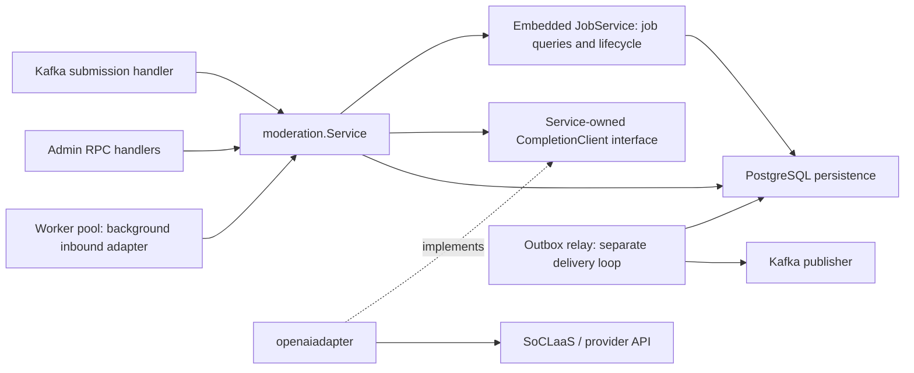
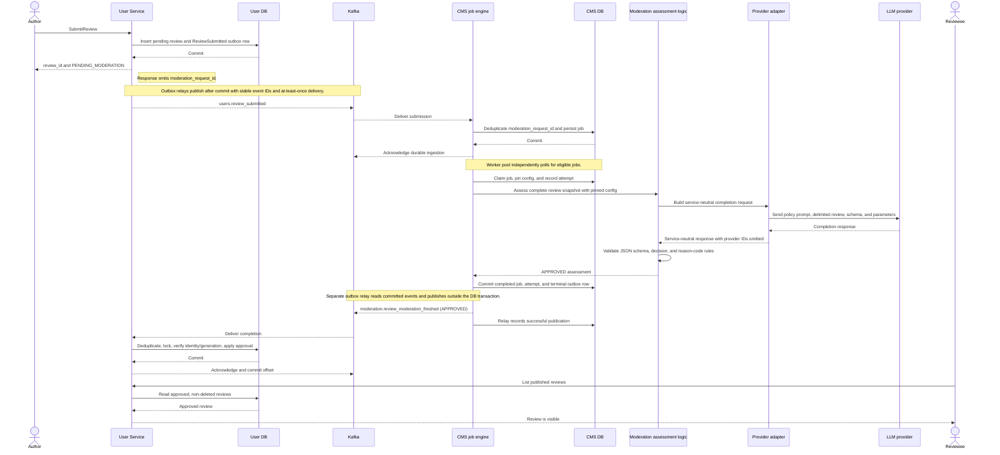
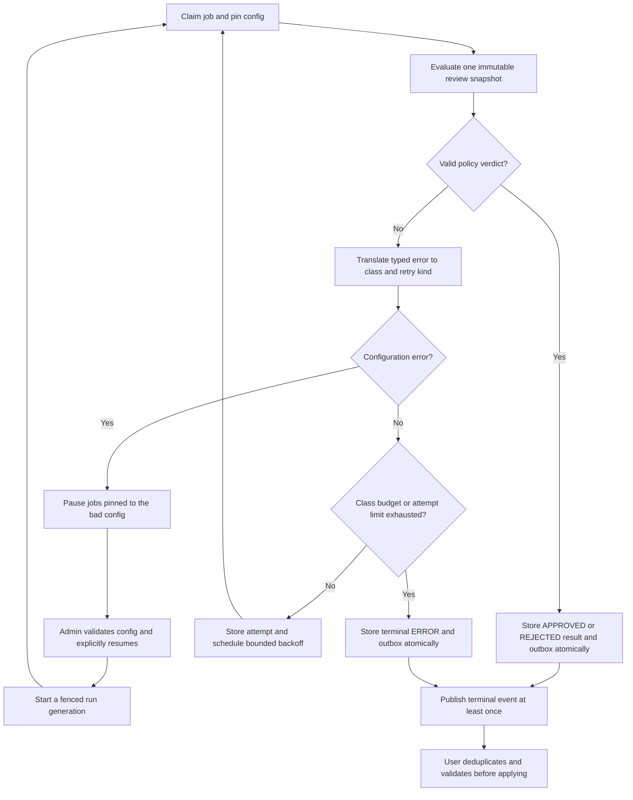

# ADR: Review content moderation

Date: 8 Nov 2026
Status: implemented for #264

## Decision

A separate `content-moderation-service` (CMS) asynchronously assesses newly
submitted review text with an LLM before publication. User Service keeps
exclusive ownership of review rows, publication, rating statistics and
administrative removal. CMS owns assessment policy, prompts, inference
integration, job execution, retries and assessment history. The two services
communicate only through Kafka events plus reviewer-scoped read RPCs; CMS
never writes to User's database and User never reads CMS's database.

### Service ownership and provider boundary

`internal/moderation.Service` owns review ingestion, durable job operations,
LLM assessment, and admin configuration. Kafka and admin RPC handlers call this
concrete service. The worker pool drives its job operations and assessment
method; scheduling, heartbeats, and cancellation stay in `worker.go`, while job
transitions and persistence live in separate files in the same package.

The hexagonal roles describe responsibilities, not separate packages for every
layer:

| Component | Architectural role | Responsibility |
| --- | --- | --- |
| Kafka submission handler and admin RPC handlers | Inbound adapters | Decode requests/events, call the service, and translate responses/errors. Read RPCs use job queries on the same service. |
| `moderation.Pool` in `worker.go` | Background inbound adapter | Drive queued work with bounded concurrency, polling, lease heartbeats, timeouts, and cancellation. |
| `moderation.Service` | Application service | Own configuration, review prompt construction, assessment, and response validation; expose job operations through its embedded `JobService`. |
| `moderation.JobService` | Application service component | Own job queries, ingestion, claiming, completion, failure, and retry rules through database operations. |
| `ConfigurationStore` and sqlc queries | Persistence adapters | Read and write PostgreSQL. Job persistence is colocated with job operations in `internal/moderation`. |
| `CompletionClient` and `ModelLister` | Outbound ports | Define the provider operations consumed by the moderation service. |
| `internal/openaiadapter` | Outbound adapter | Implement the provider contracts and translate provider responses/errors into service-owned types. |
| `outbox.Relay` | Background delivery adapter | Poll committed outbox rows, publish through its injected Kafka publisher, and record successful delivery. |

`Service` and `JobService` are called by these entry points; neither starts a
timer or goroutine. The composition root in `cmd/server/dependencies.go` wires
them together and supplies the same service to the worker's job-operation and
assessment interfaces. The pool starts worker goroutines, claims eligible jobs,
calls `Service.AssessReview`, and records the outcome through job operations.
Workers immediately look for more work after processing a job; they wait for the
poll interval when no job/configuration is available and back off on claim errors.

Completion saves the verdict, attempt, and outbox row in one database
transaction. The worker does not call the Kafka publisher. The independently
running outbox relay claims committed rows, releases the database transaction
before publishing, and records delivery afterward. A crash between publication
and acknowledgement can cause redelivery with the same event ID, so consumers
must deduplicate. Polling for jobs and polling for outbox delivery are separate
background loops.

`Service` embeds `JobService`, which provides both job queries and lifecycle
operations. Owner and admin RPC handlers receive the same `Service` and use its
job queries. Response conversion lives in `internal/rpc/review/projection.go`:
it exposes job summaries and bounded attempt history, excluding raw diagnostics.
The RPC package is named for the review moderation API contract. Review records
and publication remain exclusively in User Service.

The service consumes `CompletionClient`, using service-owned request and
response types. `internal/openaiadapter` implements that interface over the
provider SDK. The SDK remains confined to that adapter. Review rubric, reason codes, and schema are concrete moderation logic.
The composition root injects dependencies; no globals or `init` registration.

The service depends on its completion interface; the provider adapter depends on
that same service-owned contract. Provider SDK types stay inside the adapter.
The worker's narrow service interfaces allow scheduling tests to use fakes;
they do not introduce a separate assessment implementation layer.

### Concurrency

Worker concurrency is **per CMS process**, configured by
`CMS_WORKER_CONCURRENCY` (default 2, positive integer). There is no distributed
semaphore, slot table or leader election; replicas scale total concurrency.
Replicas share the queue safely through atomic claims
(`FOR UPDATE SKIP LOCKED`), claim tokens, leases with heartbeats and fenced
completion/retry updates keyed on (job, run generation, claim token). Workers
acquire shared local inference capacity before claiming, verify ownership before
calling the service assessment method, and cancel pending heartbeat I/O when inference ends.
Detached release/rollback cleanup has a two-second deadline. Crash
recovery may repeat an external inference; exactly-once provider execution is
not claimed.

### Event contracts

Independent Kafka contracts (not the RPC `Review` types):

- `users.review_submitted` (`users.events.v1.ReviewSubmitted`), published by
  User from the **same sqlc transaction** that inserts the pending review.
  Carries a stable `event_id`, `moderation_request_id`, `review_id`,
  authenticated `reviewer_id`, `content_revision` and the complete immutable
  comment.
- `moderation.review_moderation_finished`
  (`moderation.events.v1.ReviewModerationFinished`), published by CMS from its
  transactional outbox on every terminal job transition. `outcome` is
  APPROVED, REJECTED or ERROR; ERROR means no valid verdict was obtained and
  never carries content reason codes. `run_generation` starts at 1 and
  increases on explicit terminal-error retry or configuration-pause recovery,
  so stale completions can be ignored. User Service also treats its first
  applied APPROVED or REJECTED verdict as final, even if a later event claims a
  higher generation. Only a technical error can advance through explicit
  retry/recovery.

Both services validate incoming events again; a protobuf default or unknown
outcome can never approve content.

### End-to-end review flow

This sequence follows the approval path. Submission returns after User commits
the review and its outbox row; it does not wait for Kafka or inference. CMS
acknowledges the submission after durable ingestion, while User publishes the
review only after it applies an approved completion.

A valid rejection follows the same terminal outbox path but remains unpublished.
A terminal technical failure produces `ERROR`, which User records as
`moderation_error`; neither result includes provider diagnostics in User's API.

### User Service persistence and publication

A new additive migration extends reviews with `moderation_status`,
`content_revision`, `moderation_request_id` and the last applied moderation
metadata; existing rows are backfilled as approved and no jobs are created for
them. All ordinary review reads, counts and reviewee statistics filter
`moderation_status = 'approved' AND deleted_at IS NULL`. Submission inserts a
pending review plus a review-specific outbox row in one transaction; a pending
review contributes nothing to statistics and is acknowledged without depending
on Kafka or CMS availability. The completion consumer deduplicates, locks the
review, re-checks reviewer/request/revision identity and generation, and applies
the outcome in one local transaction before acknowledging. The first approved
or rejected verdict is final even if a later event claims a higher generation;
only a technical error can advance through explicit retry/recovery.
Administrative removal stays separate: an approval cannot clear `deleted_at`
or bypass removal, and automated rejections never fabricate admin-removal
audits.

### CMS queue semantics

Jobs are created at most once per `moderation_request_id` (the job uniqueness
is the ingestion inbox); duplicate deliveries are no-ops after confirming
immutable fields agree; undecodable-but-valid events are quarantined and
acknowledged. Retries are durable with capped exponential backoff and jitter,
an overall attempt budget including crash recovery and shutdown releases,
a smaller bounded budget for schema-invalid output, and no retry storm for
configuration errors (credentials, unsupported model/parameters): these pause
processing with a surfaced error class until an admin corrects configuration.
Every attempt is recorded append-only; terminal decisions are never overwritten
without trace; API keys are never stored and raw provider bodies, prompts or
hidden reasoning are never exposed.

### Runtime review rubric

Administrators can edit the system message, the instructions sent to the LLM,
when saving a configuration draft. If the save request leaves this field out or
sends an empty string, the service fills in its built-in starting rubric and
saves that text in the immutable version. The draft test and workers use the
saved text. A running job and its automatic retries keep using their pinned
version when the active version changes. A migration fills existing versions
with the built-in starting rubric. The system message controls the LLM's
instructions; the service code still controls the required output format and
accepted reason codes. The admin UI edits the system message alongside model
and inference parameters.

### Assessment errors and handling boundaries

The moderation service and provider adapter exchange service-owned types. The OpenAI
adapter is the only layer that knows SDK errors: it maps HTTP and transport
failures into `moderation` errors, replaces provider diagnostics with bounded
safe messages, and copies only content, finish reason, refusal, and model into
the neutral response. It does not copy provider request/completion IDs, headers,
credentials, or raw error bodies. The service turns refusals, empty or
truncated responses, and schema violations into typed technical errors; none
can be interpreted as a content verdict.

`moderation.Classify` is the single mapping from concrete provider and
response-validation errors to a stable stored class, retry handling category,
and optional `RetryAfter`. Admin draft tests and job execution use the same
mapping. Errors are inspected directly with `errors.Is`/`errors.As`; there is no
second translation wrapper around the assessment. Internal operations can
attach explicit metadata with `ClassifiedError`, preserving the original error
for inspection. Retry budgets, pause/recovery, and scheduling remain job logic.

| Assessment/provider failure | Stable `ErrorClass` | Durable job handling |
| --- | --- | --- |
| `ErrEmptyResponse`, `ErrInvalidOutput` (empty, malformed, truncated, or schema-invalid output) | `invalid_output` | Small fixed budget (2 attempts by default), then terminal `ERROR`. |
| `ErrRefusal` (provider refusal or content filter) | `content_filter` | Small fixed budget (2 attempts by default), then terminal `ERROR`. |
| `ErrRateLimited` (HTTP 429) | `rate_limited` | Durable retry; honor `Retry-After` when present, capped at max delay; otherwise jittered backoff. |
| `ErrTimeout` (request deadline or transport timeout) | `timeout` | Durable retry with jittered backoff. |
| `ErrConnection` (network failure or HTTP 5xx) | `connection` | Durable retry with jittered backoff. |
| `ErrConfiguration` (invalid credentials, model, parameters, or other HTTP 4xx) | `configuration` | Pause the pinned configuration; wait for validated configuration and explicit recovery. |
| Unrecognized error | `server_error` | Durable retry with jittered backoff. |

The default overall attempt limit is 5 per run generation. Invalid-output and
content-filter budgets apply within that limit. A configuration error is
recorded and pauses the job rather than exhausting the attempt budget;
configuration recovery explicitly fences old work and starts a new generation.
Caller cancellation and lost claims are handled by the worker's
release/fencing path rather than treated as a content verdict. A live provider
deadline is classified as `timeout`.

Only the stable class is persisted with an attempt: the database `detail`
value is set to that class, not the wrapped error text. CMS's admin job RPC
exposes the class and omits the diagnostic field; owner-facing job summaries
omit error classes. The completion Kafka event omits the technical class and
diagnostic; its outcome is APPROVED, REJECTED, or ERROR, with content reason
codes only for REJECTED. User Service keeps moderation status, verdict
metadata, and rejection reasons, but does not surface the technical error
class. An author sees `moderation_error`, not the provider or worker failure.

Control-plane RPC errors stay separate from assessment outcomes. CMS maps
invalid input to `invalid_argument`, missing jobs to `not_found`, and stale
configuration/retry guards to `failed_precondition`; authorization failures
remain authentication/permission errors. Draft inference tests return a
bounded `error_class` in their response rather than a job retry or provider
diagnostic. User's completion consumer acknowledges duplicates, invalid or
unmatched events, missing or removed reviews, and stale/conflicting results; it
returns transaction failures for Kafka redelivery. Once User applies APPROVED
or REJECTED, a later result cannot change that content verdict even if it
carries a higher generation.

Admin configuration uses immutable configuration versions plus an active
pointer with optimistic concurrency; already-started jobs keep their pinned
version. `moderation.Transitions` centralizes administrative retry and
pause-recovery writes within local transactions, called by
`Service.RetryErroredJob` and `ConfigurationStore.ActivateAndResume`. Job writers lock
the job before its attempt records to keep recovery and finalization lock order
consistent. Lease writes acquire the row lock first and check database-clock
expiry in a separate statement: a predicate evaluated before a lock wait cannot
prove the lease is still live afterward. This also applies to relay acknowledgements.
Explicit recovery moves all nonterminal jobs pinned to paused
versions (including in-flight jobs) to a new generation and fences old claims.
A changed endpoint requires saving and validating a new immutable configuration;
the worker verifies its endpoint/model fingerprint before consuming attempts.
A missing configuration or API key never loses submissions: jobs
queue without burning attempts and setup status surfaces what is missing.

### Reviewer-scoped reads

`user.review.v1.ReviewService/ListUnpublishedReviewsForUser` is the canonical
unpublished projection (pending/rejected/moderation-error, by author, with
backend authorization before lookup). CMS's
`moderation.review.v1.ReviewModerationService/GetReviewModerationJobsForReviewer`
returns bounded job summaries for the request IDs of one User page; missing
jobs mean not-yet-ingested, never approval. User's publication status always
wins over CMS progress in the UI.

## Alternatives considered

- **Synchronous moderation in User's submit path**: couples User to inference
  latency/availability and blocks submissions; rejected.
- **In-process queue in User Service**: spreads moderation policy into User
  and mixes retry/lease machinery into a domain that owns publication;
  rejected.
- **Shared `pkg/llm` framework**: one consumer today; premature. The
  completion port inside CMS is the replaceable boundary.
- **Distributed concurrency cap**: rejected as unnecessary cluster-wide state;
  per-process limits plus replica count are explicit and sufficient.

## Consequences

- Publication latency now includes moderation time; reviewers see their
  review as pending on the new unpublished page until CMS finishes.
- Moderation outages degrade to a growing pending queue, never lost
  submissions.
- A rejected review is retained and visible to its author and admins but does
  not affect ratings; rejection is distinct from technical error and from
  admin removal.
