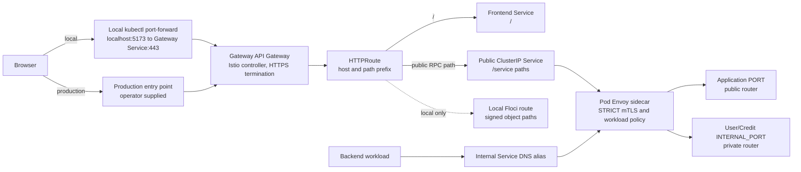

# Kubernetes developer setup

Kubernetes is an additional way to run FoC. Docker Compose remains supported;
do not run both stacks at the same time because their default host ports
overlap.

## First run

Prerequisites: Docker, `make`, [aqua v2.65.2 or newer](https://aquaproj.github.io/docs/install/),
and OpenSSL, plus about 4 CPUs and 8 GiB of memory. Internet access is needed
for pinned Kubernetes tools and container images. Bun 1.4.3 is installed by
aqua under the ignored `.tools/aqua/` directory. You do not need Node.js or Bun
globally.

Before the first deployment, approve this repository's aqua policy once:

```sh
AQUA_ROOT_DIR="$PWD/.tools/aqua" aqua policy allow "$PWD/aqua-policy.yaml"
```

Use the same `AQUA_ROOT_DIR` for `make k8s-*` if you choose a different path.
Run the allow command again if `aqua-policy.yaml` changes.

To update a tool pin, edit `aqua.yaml`, `.bun-version`, or `.istio-version`,
then refresh `aqua-checksums.json` with
`AQUA_ROOT_DIR="$PWD/.tools/aqua" aqua update-checksum`.

The managed local cluster installs the vendored Gateway API v1.6.0 Standard
CRDs before Istio. External clusters must already serve Gateway API v1 CRDs and
have Istio installed as the `istio` GatewayClass controller.

```sh
cp .env.example .env
# Bootstrap the first FoC administrator, then start/deploy the stack.
K8S_BOOTSTRAP_SUPERADMIN_EMAIL=admin@example.test make k8s-up
```

The first run creates a local `kind` cluster, installs Gateway API Standard
CRDs and Istio, builds and deploys
the application and dependencies, provisions the databases, and runs database
migrations. It may take several minutes. It does not erase data on later runs.
The first administrator signs in through the magic-link flow; local email is
available in Mailpit.

By default, `.env.example` enables three local-only forwards:

- FoC, using the gateway: <https://localhost:5173>
- Kafka UI: <http://localhost:8080>
- Mailpit: <http://localhost:8025>

The local HTTPS certificate is self-signed. Trust
`.local/k8s/secrets/tls.crt` in your browser or use it with a TLS-aware client;
the setup never changes your machine's trust store. Kafka UI has its own
operator login; credentials are in `.local/k8s/secrets/kafka-ui-user` and
`kafka-ui-password`.

## Ports and stopping

Edit `K8S_HTTPS_PORT`, `K8S_KAFKA_UI_PORT`, and `K8S_MAILPIT_PORT` in `.env` to
choose host ports. Leave any value blank to disable just that forward. A
conflicting port is reported before deployment, so stop Compose first or pick
another port.

When at least one forward is enabled, `make k8s-up` stays in the terminal while
the forwards run. Press Ctrl+C to stop the forwards; the Kubernetes cluster and
its data keep running. If every value is blank, deployment completes and the
command returns to the prompt. Running `make k8s-up` again attaches configured
forwards to the existing cluster. Use distinct host ports to run Compose and
Kubernetes together.

To remove the local cluster and its PostgreSQL/Kafka data, explicitly run:

```sh
K8S_CONFIRM_DELETE=foc make k8s-delete-cluster
```

This keeps local credentials but deletes the cluster's persistent data. To
start with fresh persistence, recreate the cluster after this command. Never
delete `.local/k8s/secrets` while retaining a database volume.

## Everyday commands

```sh
make k8s-status                         # pods, jobs, storage and warnings
make k8s-smoke                          # HTTPS and public User Health RPC through the gateway
make k8s-deploy service=user-service    # rebuild and update one service
make k8s-kafka-ui                       # attach only the Kafka UI forward
make k8s-mailpit                        # attach only the Mailpit forward
```

`make k8s-access` similarly attaches only the HTTPS gateway forward. For the
managed local cluster it rejects ports that differ from deployed browser origins;
after changing `K8S_HTTPS_PORT`, run a full `make k8s-up` or `make k8s-deploy`
to update application configuration first. These access commands stay attached
until Ctrl+C.

For pod logs, `kubectl exec`, database debugging, security boundaries, external
clusters, and production-overlay setup, see the
[Kubernetes operations runbook](../../docs/runbooks/kubernetes.md).

## Request path and router boundaries

The same application binaries run in Compose and Kubernetes. Applications
listen on `PORT` and, where needed, `INTERNAL_PORT`; they do not detect a mesh
or select a deployment mode. Kubernetes adds the Gateway API resources and
Istio workload networking around those listeners.



For local development, the browser opens `https://localhost:5173`; the
foreground port-forward sends that traffic to the Gateway Service in
`istio-ingress`. The Gateway terminates browser TLS. Gateway API `HTTPRoute`
resources select a backend by hostname and URL path prefix: `/` goes to the
frontend, while listed protobuf service paths go to a service's public
ClusterIP Service. A Connect request path has the form
`/<package>.<service>/<method>`. The route does not authenticate a user or
authorize an RPC method. The backend Envoy sidecar carries the mesh connection
to the pod, and the application router dispatches the Connect method. The
response follows the same path back to the browser. The local overlay also
routes signed Order image paths to Floci; that route carries objects, not
service RPCs.

The browser's initial `GET /` reaches the frontend, which renders its loading
shell. After hydration, the browser restores the session and requests Connect
RPCs from the same HTTPS origin. Its service URLs point to the Gateway origin;
the auth interceptor adds a bearer token to protected calls, which the
application validates. Istio STRICT mTLS and `AuthorizationPolicy` check the
calling workload identity at the network boundary. They do not replace
application JWT, role, or ownership checks.

| Service | Public listener (`PORT`) | Internal listener (`INTERNAL_PORT`) |
| -- | -- | -- |
| User | Health, Auth, Profile, and User Admin RPCs | Public-key RPC only; no Gateway route |
| Credit | Health and Credit Account RPCs | Reservation RPCs; kept private to Order in Kubernetes |
| Supplier, Order, Communication | All currently mounted RPCs | Empty router for now; Kubernetes internal aliases target the public listener |

For User and Credit, the internal Service targets `INTERNAL_PORT`. Supplier,
Order, and Communication keep their internal routers empty for now, so those
internal aliases target the public listener as noted in the table.

The public and internal Kubernetes Service names both resolve only inside the
cluster. `-external` means “targets the public application listener,” not
internet exposure. Application RPC routes point only to public Services, and
the Gateway workload identity is explicitly denied access to port 8081. See the
[operations runbook](../../docs/runbooks/kubernetes.md) for service DNS,
policies, jobs, secrets, and production requirements.

## Current application coverage and platform support

The stack includes User, Supplier, Order, Credit, Communication, frontend and
the local Order image store. Credit has its own database, migration Job, public
RPC Service and private reservation Service. Its internal listener is restricted
by Istio to the `order-service` workload identity. The complete D3 business
workflow is not claimed by this deployment. Communication starts with Telegram
disabled unless a bot credential is configured. To configure it on first setup, set
`K8S_TELEGRAM_BOT_TOKEN`; it is persisted in the private
`.local/k8s/secrets/TELEGRAM_BOT_TOKEN` file. To change it later, edit that file
and run a full deployment. An empty file disables Telegram. Never share a bot
token with another running poller.

Credit-dependent Order operations can use the deployed Credit backend. The
internal listener does not verify an application credential, so its Kubernetes
reachability is limited by the Istio principal policy; see
`LANDMINES/credit-internal-listener-unauthenticated.md`.

Linux and macOS hosts on amd64 or arm64 are supported. Docker Desktop must be
running on macOS. Clear any `DOCKER_DEFAULT_PLATFORM` override left over from
the Compose Apple Silicon workaround before starting kind. Kubernetes uses a
native multiarch PostGIS image; the Compose-specific Apple Silicon workaround
does not apply to this deployment. Bun automatically reads root `.env`;
explicitly exported values take precedence.
