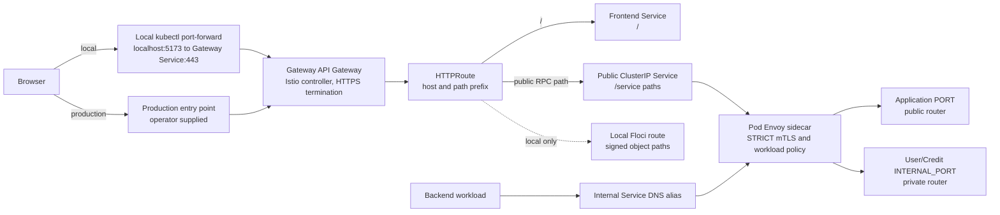

# Kubernetes developer setup

Kubernetes is an additional way to run FoC. Docker Compose remains supported;
do not run both stacks at the same time because their default host ports
overlap.

## First run

Prerequisites: Docker, `make`, [aqua v2.65.2 or newer](https://aquaproj.github.io/docs/install/),
and OpenSSL, plus about 4 CPUs and 8 GiB of memory. Internet access is needed
for pinned Kubernetes tools and container images. Bun 1.4.3 is installed by
aqua under the ignored `.tools/aqua/` directory. You do not need Node.js or Bun
globally.

Install aqua itself (the only manual tool prerequisite):

```sh
brew install aquaproj/aqua/aqua        # with Homebrew
# or without Homebrew:
curl -sSfL "https://raw.githubusercontent.com/aquaproj/aqua-installer/v3.1.0/aqua-installer" \
  | bash -s -- "-v v2.65.2"
mkdir -p ~/.local/bin && mv ./aqua ~/.local/bin/ && export PATH="$HOME/.local/bin:$PATH"
```

Before the first deployment, approve this repository's aqua policy once:

```sh
AQUA_ROOT_DIR="$PWD/.tools/aqua" aqua policy allow "$PWD/aqua-policy.yaml"
```

Use the same `AQUA_ROOT_DIR` for `make k8s-*` if you choose a different path.
Run the allow command again if `aqua-policy.yaml` changes.

To update a tool pin, edit `aqua.yaml`, then refresh `aqua-checksums.json` with
`AQUA_ROOT_DIR="$PWD/.tools/aqua" aqua update-checksum`.

The managed local cluster installs the vendored Gateway API v1.6.0 Standard
CRDs before Istio. External clusters must already serve Gateway API v1 CRDs and
have Istio installed as the `istio` GatewayClass controller.

```sh
cp .env.example .env
# Bootstrap the first FoC administrator, then start/deploy the stack.
K8S_BOOTSTRAP_SUPERADMIN_EMAIL=admin@example.test make k8s-up
```

The first run creates a local `kind` cluster, installs Gateway API Standard
CRDs and Istio, builds and deploys
the application and dependencies, provisions the databases, and runs database
migrations. It may take several minutes. It does not erase data on later runs.
The first administrator signs in through the magic-link flow; local email is
available in Mailpit.

By default, `.env.example` enables three local-only forwards:

- FoC, using the gateway: <https://localhost:5173>
- Kafka UI: <http://localhost:8080>
- Mailpit: <http://localhost:8025>

The local HTTPS certificate is self-signed. Trust
`.local/k8s/secrets/tls.crt` in your browser or use it with a TLS-aware client;
the setup never changes your machine's trust store. Kafka UI has its own
operator login; credentials are in `.local/k8s/secrets/kafka-ui-user` and
`kafka-ui-password`.

## Ports and stopping

Edit `K8S_HTTPS_PORT`, `K8S_KAFKA_UI_PORT`, and `K8S_MAILPIT_PORT` in `.env` to
choose host ports. They may also be exported for a single invocation
(`K8S_HTTPS_PORT=9443 make k8s-up`); passing them as make arguments
(`make k8s-up K8S_HTTPS_PORT=9443`) does not reach the operator script. Leave
any value blank to disable just that forward. A
conflicting port is reported before deployment, so stop Compose first or pick
another port.

When at least one forward is enabled, `make k8s-up` stays in the terminal while
the forwards run. Press Ctrl+C to stop the forwards; the Kubernetes cluster and
its data keep running. If every value is blank, deployment completes and the
command returns to the prompt. Running `make k8s-up` again attaches configured
forwards to the existing cluster. Use distinct host ports to run Compose and
Kubernetes together.

To remove the local cluster and its PostgreSQL/Kafka data, explicitly run:

```sh
K8S_CONFIRM_DELETE=foc make k8s-delete-cluster
```

This keeps local credentials but deletes the cluster's persistent data. To
start with fresh persistence, recreate the cluster after this command. Never
delete `.local/k8s/secrets` while retaining a database volume.

## Everyday commands

```sh
make k8s-status                         # pods, jobs, storage and warnings
make k8s-smoke                          # frontend, public health RPCs, private-route boundary, listener ports
make k8s-deploy service=user-service    # rebuild and update one service
make k8s-access                         # attach every configured forward, skipping occupied ports
make k8s-kafka-ui                       # attach only the Kafka UI forward
make k8s-mailpit                        # attach only the Mailpit forward
```

`make k8s-access` attaches every forward configured in `.env` — the HTTPS
gateway, Kafka UI and Mailpit — in one command. A forward whose port cannot be
bound (for example, a local tool already listening) is skipped with a note
while the rest stay attached; if none can be attached, the command fails.
For the managed local cluster it rejects gateway ports that differ from
deployed browser origins; after changing `K8S_HTTPS_PORT`, run a full
`make k8s-up` or `make k8s-deploy` to update application configuration first.
These access commands stay attached until Ctrl+C.

For pod logs, `kubectl exec`, database debugging, security boundaries, external
clusters, and production-overlay setup, see the
[Kubernetes operations runbook](../../docs/runbooks/kubernetes.md).

## Manifest layout

| File | Purpose |
| -- | -- |
| `platform/namespaces.yaml` | Creates `foc` (apps, sidecar injection), `istio-system`, and `istio-ingress`. |
| `platform/admission.yaml` | API-server policy: `foc` pods must carry the pinned Istio sidecar; rejects injection opt-outs, host networking, and capture overrides. |
| `platform/istiod-values.yaml` | Helm values used to install istiod from the pinned archive's charts: native sidecars, proxy resources, access logs with query strings stripped. |
| `platform/gateway-api/standard-install.yaml` | Vendored Gateway API v1.6.0 CRDs. |
| `platform/gateway-api/README.md` | Provenance and pin of the vendored CRDs. |
| `base/dependencies/accounts.yaml` | One ServiceAccount per workload — the identities Istio principals refer to. |
| `base/dependencies/config.yaml` | `foc-config`: shared runtime settings, browser-facing origins, internal service URLs. |
| `base/dependencies/postgres.yaml` | PostgreSQL/PostGIS StatefulSet with its PVC. |
| `base/dependencies/kafka.yaml` | Kafka broker StatefulSet, advertising its in-cluster FQDN. |
| `base/dependencies/kafka-ui.yaml` | Kafka operator UI; private port-forward access with its own login. |
| `base/dependencies/security.yaml` | STRICT mTLS, default-deny, and the per-caller authorization policies. |
| `base/gateway/gateway.yaml` | The `foc-public` Gateway: HTTPS listener, local TLS Secret, route attachment rules. |
| `base/applications/gateway.yaml` | The public HTTPRoute allowlist: one route per public protobuf service plus the frontend. |
| `base/applications/<service>.yaml` | Deployment and Service(s) per app (User/Credit also have internal Services); probes use the image's healthcheck binary. |
| `base/initialization/*-migrate.yaml` | Per-service Goose migration Jobs. |
| `base/initialization/kafka-init.yaml` | Topic-creation Job driven by `infra/kafka/topics.conf`. |
| `base/provisioning/db-provision.yaml` + `provision.sh` | Job creating per-service database roles and installing PostGIS extensions. |
| `base/mailpit/`, `base/floci/` | Local-only dev mailbox and S3-compatible image store (Floci adds its own gateway route). |
| `overlays/local/`, `overlays/production/` | Kustomize patches: local forwards and storage; production hostname, certificate, and origins (template). |

Environments are layered with Kustomize: `base/` holds every resource with
local defaults — its five stage directories are the deployable Kustomize
packages (`base/` itself has no root kustomization; stages are applied through
an overlay) — and each `overlays/<environment>/<stage>/` directory applies
small declarative patches on top of it. The operator script renders
every stage with `kubectl kustomize` (built into kubectl — no separate tool)
and, before applying, wraps the output in a generated kustomization that
rewrites image registry and tag, so image references are decided in exactly
one place. Inspect the rendered YAML of a stage with
`bun run scripts/k8s/k8s.ts render <stage>`.

## Deployment stages

The deploy applies five ordered stages — `gateway`, `dependencies`,
`provisioning`, `initialization`, `applications` — each a directory under both
`base/` and `overlays/<environment>/`. Stages run in dependency order, and each
is verified before the next: a failed Job (for example, a migration) stops the
deploy, so an application never starts before its database exists and its
schema is current. Every object also carries a `foc.dev/stage` label naming its
stage, e.g. `kubectl -n foc get jobs -l foc.dev/stage=initialization`.

## Moving to a managed cluster (for example Amazon EKS)

1. Create the EKS cluster; install a compatible Istio — Gateway API v1 CRDs
   must already exist (the bootstrap only verifies them). See the runbook for
   CNI and Pod Security notes.
2. Push images: `K8S_IMAGE_PREFIX=<account>.dkr.ecr.<region>.amazonaws.com/foc
   K8S_IMAGE_TAG=<immutable> K8S_PUSH_IMAGES=1`.
3. Complete `overlays/production/`: real hostname and `foc-public-tls`
   (`gateway/`), real browser origins in `foc-config` (`dependencies/`),
   remove the template warning.
4. Create every Secret from the runbook table; prefer RDS/MSK over the
   in-cluster single-node PostgreSQL/Kafka; replace Floci with real S3.
5. Deploy: `K8S_CONTEXT=<cluster>
   K8S_OVERLAY=infra/k8s/overlays/production K8S_IMAGE_PREFIX=…
   K8S_PUSH_IMAGES=1 make k8s-deploy`. Verification is manual on the cluster
   (`kubectl get`/`logs`) — the gateway smoke check targets the local overlay
   only.

Exposing the gateway: local development uses `kubectl port-forward`; on EKS
install the AWS Load Balancer Controller and patch the
`foc-public-infrastructure` ConfigMap (the Gateway's `parametersRef`, see
`base/gateway/gateway.yaml`) in the production overlay:

```yaml
service: |
  spec:
    type: LoadBalancer
    metadata:
      annotations:
        service.beta.kubernetes.io/aws-load-balancer-type: "external"
        service.beta.kubernetes.io/aws-load-balancer-scheme: "internet-facing"
        service.beta.kubernetes.io/aws-load-balancer-nlb-target-type: "ip"
```

The NLB passes TCP 443 through — TLS still terminates at the Envoy gateway
with `foc-public-tls`; point a Route 53 alias at the NLB hostname. No
application manifests change.

## Container images

Every image builds from the repository root as context. The Go services share
`docker/k8s/service.Dockerfile`:

```sh
docker build -f docker/k8s/service.Dockerfile --build-arg SERVICE=user-service -t foc-user-service:production .
```

`SERVICE` must be `user-service`, `supplier-service`, `order-service`,
`credit-service`, or `communication-service`. Each image builds with Go 1.27
and runs `/app/server` as UID/GID 65532 with system CA certificates. Local
module replacements are included in the build context. `make k8s-deploy` builds
the same images with the configured registry prefix and tag. The frontend image
is documented in [the frontend README](../../frontend/README.md).

The per-service migration Jobs share `docker/k8s/migrations.Dockerfile`, which
bundles goose and every service's schema directory under `/migrations`.

The Kafka initialization Job uses `docker/k8s/kafka-init.Dockerfile`:

```sh
docker build -f docker/k8s/kafka-init.Dockerfile -t foc/kafka-init:local .
```

This image packages the authoritative `infra/kafka/topics.conf`, topic creation
script, and `kafka/` schemas under `/setup` and `/schemas`. Set `KAFKA_BROKERS`
at runtime; topic configuration and schemas do not need separate ConfigMaps.

## Request path and router boundaries

The same application binaries run in Compose and Kubernetes. Applications
listen on `PORT` and, where needed, `INTERNAL_PORT`; they do not detect a mesh
or select a deployment mode. Kubernetes adds the Gateway API resources and
Istio workload networking around those listeners.


Follow one browser request end to end (letters match the diagram):

1. **Browser → Gateway** (`PF`/`EXT` → `G`): the origin resolves to the local
   port-forward or the operator's entry point; the `foc-public` listener
   terminates TLS.
2. **Gateway → Service** (`R` → `S`): the matched `HTTPRoute` names a backend
   Service (`user-service-external:8080`); Istio's controller has translated
   that reference into the Service's ready pod endpoints, and the gateway proxy
   load-balances across them — one pod of the Deployment.
3. **Pod → sidecar** (`E`): the capture rules installed by `istio-init`
   redirect the connection to the pod's Envoy, which terminates the mesh mTLS
   hop and evaluates the namespace policies (source principal, destination
   port) before forwarding anything.
4. **Sidecar → app** (`A`): admitted traffic is forwarded as plaintext over the
   pod's loopback to `127.0.0.1:<PORT>` — the public listener — where the
   application router dispatches the Connect method. Readiness probes decide
   whether the pod stays in the Service's endpoint list from step 2.
5. **In-cluster callers** (`C` → `D` → `E` → `I`) take the same steps with the
   `-internal` Service DNS and their own outgoing sidecar; the gateway is not
   involved.

For local development, the browser opens `https://localhost:5173`; the
foreground port-forward sends that traffic to the Gateway Service in
`istio-ingress`. The Gateway terminates browser TLS. Gateway API `HTTPRoute`
resources select a backend by hostname and URL path prefix: `/` goes to the
frontend, while listed protobuf service paths go to a service's public
ClusterIP Service. A Connect request path has the form
`/<package>.<service>/<method>`. The route does not authenticate a user or
authorize an RPC method. The backend Envoy sidecar carries the mesh connection
to the pod, and the application router dispatches the Connect method. The
response follows the same path back to the browser. The local overlay also
routes signed Order image paths to Floci; that route carries objects, not
service RPCs.

The browser's initial `GET /` reaches the frontend, which renders its loading
shell. After hydration, the browser restores the session and requests Connect
RPCs from the same HTTPS origin. Its service URLs point to the Gateway origin;
the auth interceptor adds a bearer token to protected calls, which the
application validates. Istio STRICT mTLS and `AuthorizationPolicy` check the
calling workload identity at the network boundary. They do not replace
application JWT, role, or ownership checks.

| Service | Public listener (`PORT`) | Internal listener (`INTERNAL_PORT`) |
| -- | -- | -- |
| User | Health, Auth, Profile, and User Admin RPCs | Public-key RPC only; no Gateway route |
| Credit | Health and Credit Account RPCs | Reservation RPCs; kept private to Order in Kubernetes |
| Supplier, Order, Communication | All currently mounted RPCs | None; single public listener |

Only User and Credit run internal listeners, so only they have internal
Services targeting `INTERNAL_PORT`. Supplier, Order, and Communication expose
every route on the public listener and run a single listener.

The public and internal Kubernetes Service names both resolve only inside the
cluster. `-external` means “targets the public application listener,” not
internet exposure. Application RPC routes point only to public Services, and
the Gateway workload identity is explicitly denied access to port 8081. See the
[operations runbook](../../docs/runbooks/kubernetes.md) for service DNS,
policies, jobs, secrets, and production requirements.

## Current application coverage and platform support

The stack includes User, Supplier, Order, Credit, Communication, frontend and
the local Order image store. Credit has its own database, migration Job, public
RPC Service and private reservation Service. Its internal listener is restricted
by Istio to the `order-service` workload identity. The complete D3 business
workflow is not claimed by this deployment. Communication starts with Telegram
disabled unless a bot credential is configured; configuration and rotation are
covered in the
[operations runbook](../../docs/runbooks/kubernetes.md#current-main-updates).

Credit-dependent Order operations can use the deployed Credit backend. The
internal listener does not verify an application credential, so its Kubernetes
reachability is limited by the Istio principal policy; see
`LANDMINES/credit-internal-listener-unauthenticated.md`.

Linux and macOS hosts on amd64 or arm64 are supported. Docker Desktop must be
running on macOS. Clear any `DOCKER_DEFAULT_PLATFORM` override left over from
the Compose Apple Silicon workaround before starting kind. Kubernetes uses a
native multiarch PostGIS image; the Compose-specific Apple Silicon workaround
does not apply to this deployment. Bun automatically reads root `.env`;
explicitly exported values take precedence.
