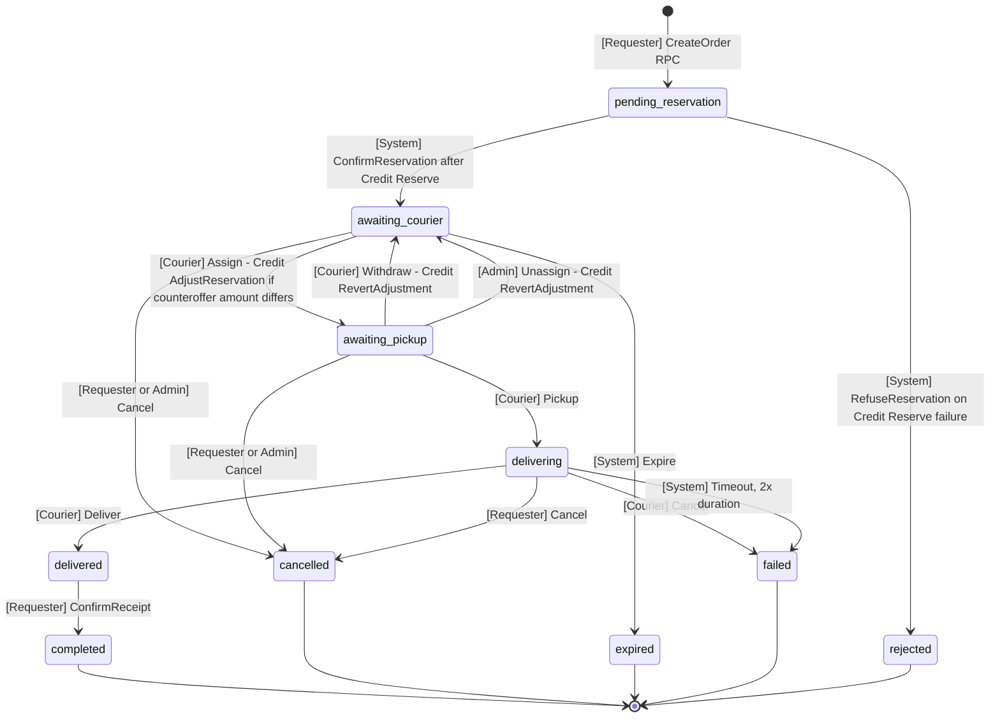
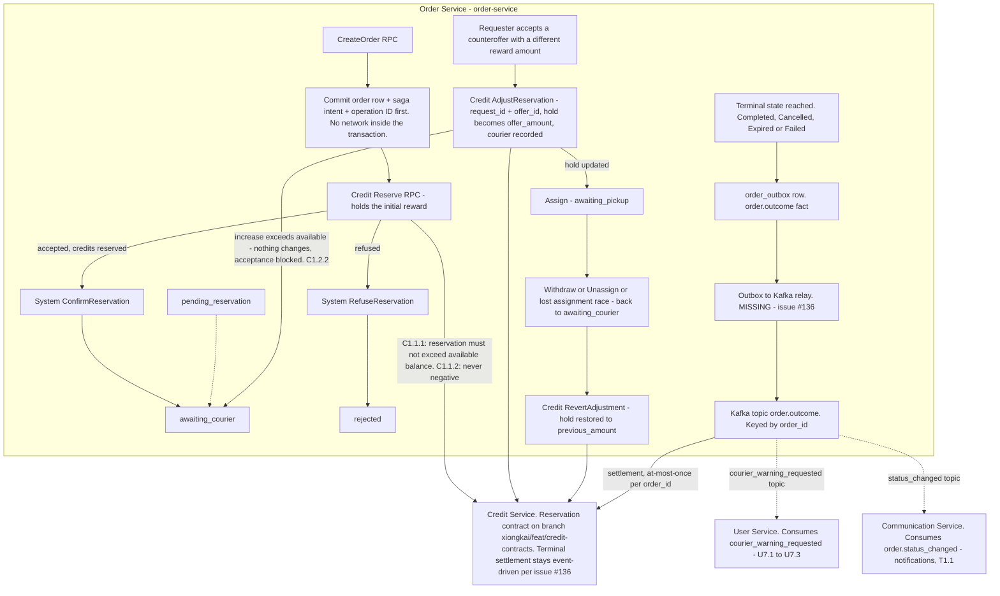
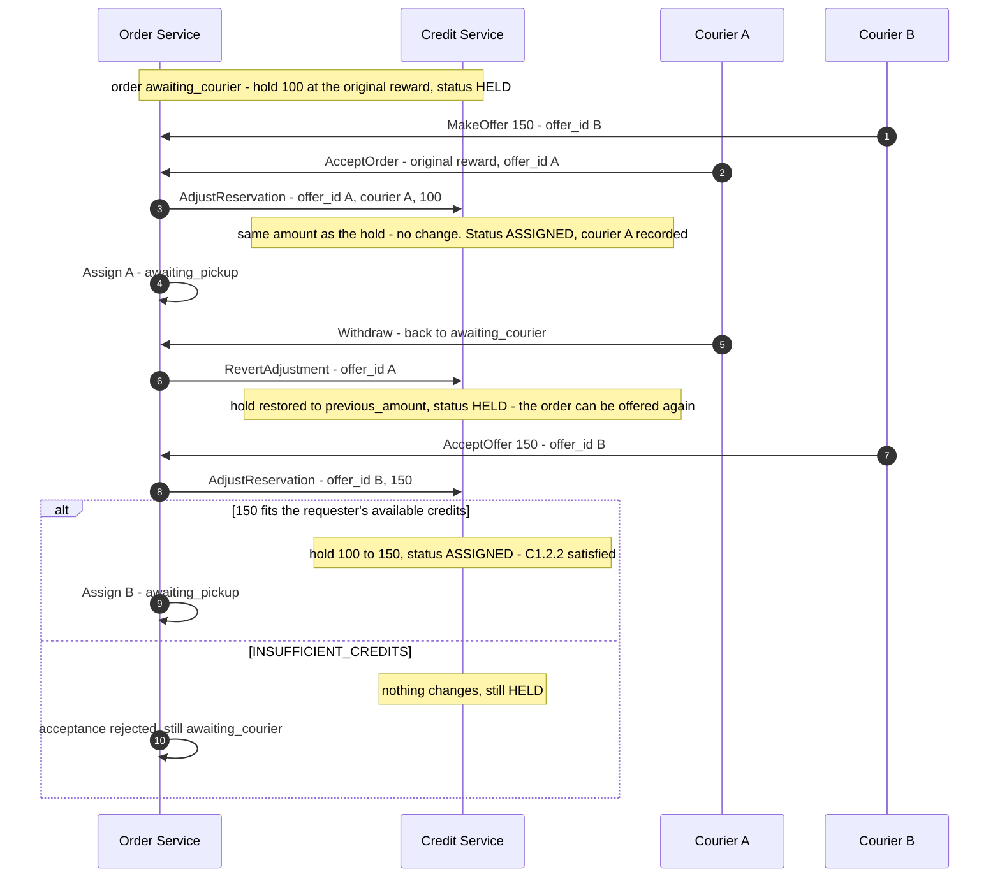
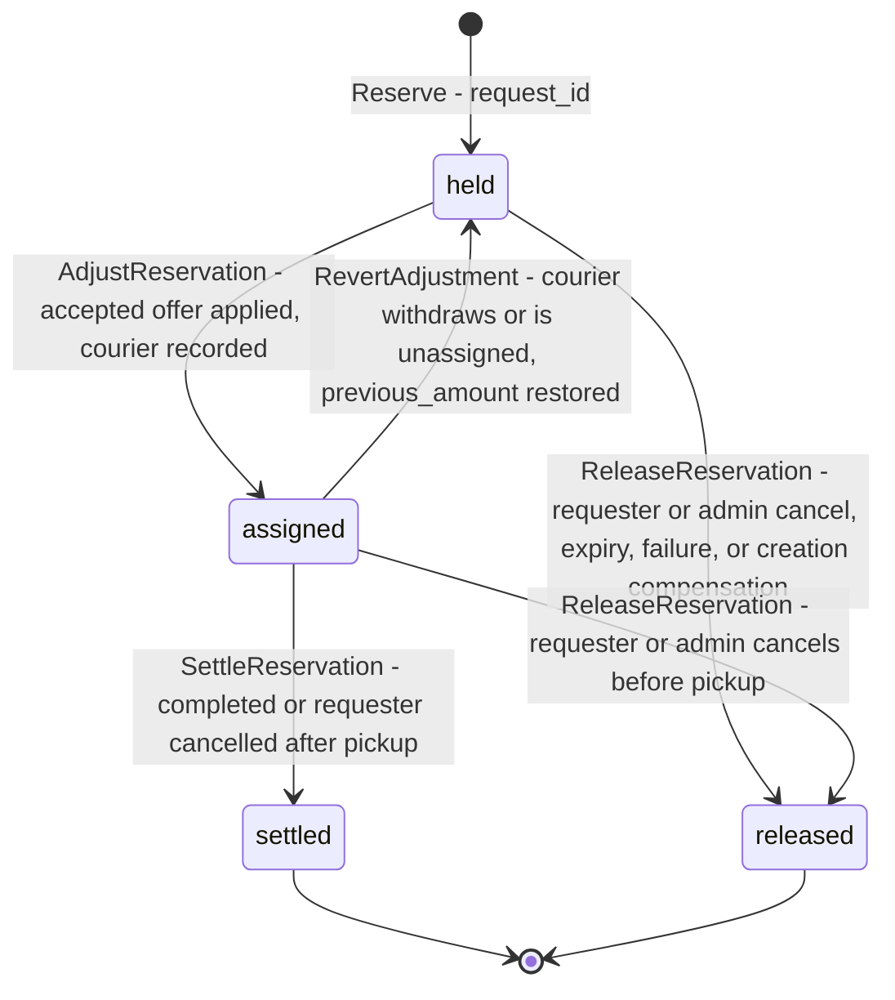
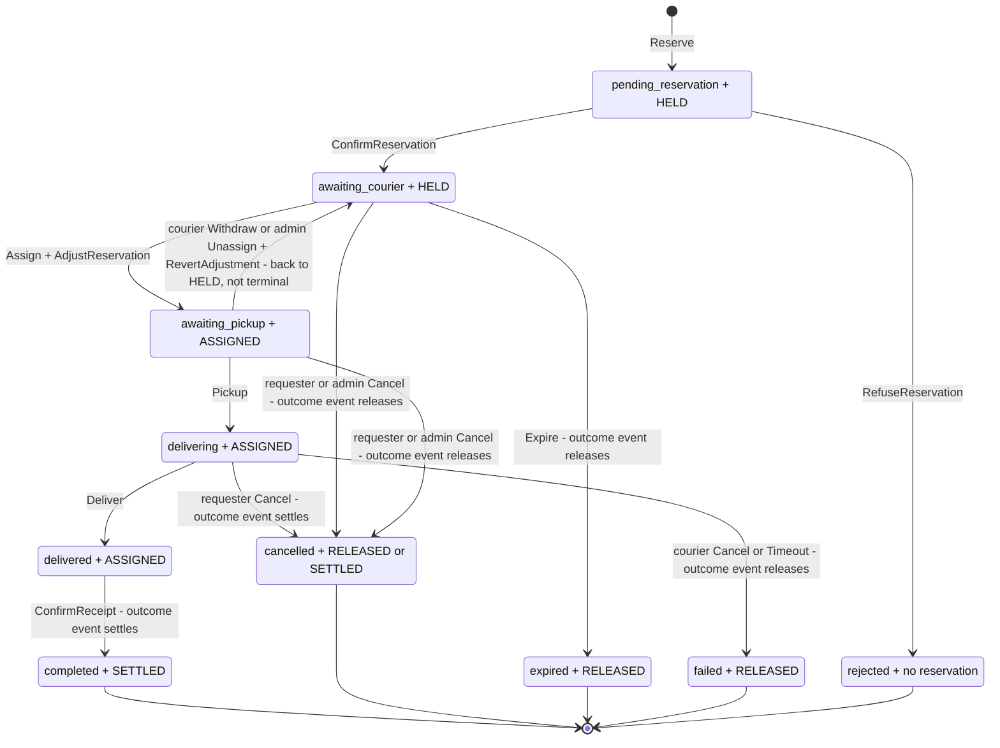
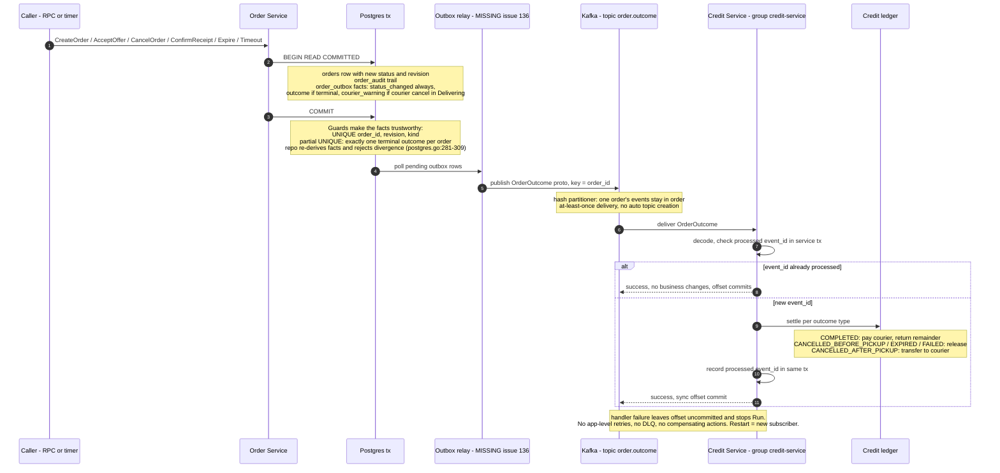

# Order Lifecycle and Credit Event Flow

Event-storming view of the Order Service lifecycle, its interface to the Credit
Service, and the publish/consume flow of Order's domain events. Grounded in
`plans/FRs.html` (Order: R1.x, Credit: C1.2.x), the concrete code in
`order-service/internal/order/` and `kafka/order/events/v1/`, and the Credit
reservation contract on branch `xiongkai/feat/credit-contracts`
(`proto/credit/v1/reservation.proto`).

**Legend (event-storming notation)**

| Symbol | Meaning |
|---|---|
| `[Command]` | an intent that triggers a transition, performed by an actor |
| `(Domain Event)` | something that happened, past tense — the orange stickies |
| `{Policy}` | "whenever X happens, then Y" — reactive rule |
| `[[Aggregate]]` | consistency boundary holding the state machine |
| `<External System>` | another service, integrated asynchronously |
| `⟵RPC⟶` | synchronous service-to-service call |
| `⟹E⟹` | domain event emitted into the outbox at that transition |

---

## 1. Order lifecycle — commands, transitions, emitted events

The state machine lives in `order-service/internal/order/transitions.go`
(destination map at lines 35-47, actor rules at 69-84). The mutation boundary
`Mutator.Mutate` (`mutation.go:17-43`) locks the row, calls `NewChange`
(`events.go:51-163`) to re-validate and build facts, and applies order + audit
+ outbox facts in one transaction.

**Facts emitted by `NewChange` (events.go:153-160), attached to transitions:**

| Fact | Emitted when | Payload highlights (`FactsPayload`, events.go:32-47) |
|---|---|---|
| `order.status_changed` | every real status change | order id, revision, requester, courier, previous/new status, action, `reserved_credits`, `after_pickup`, timestamps |
| `order.outcome` | additionally, only when reaching completed / cancelled / expired / failed | same, plus delivery duration and pickup/delivered timestamps for the lateness rule |
| `order.courier_warning_requested` | only when the *courier* cancels during Delivering | identifies courier and originating order (drives User Service warning, R1.4.1) |

Creation emits no status fact (same-status). Metadata amendments and
`RecordItemLocation` produce audit only. `rejected` emits nothing to Credit —
nothing was ever reserved.

**Credit RPC per lifecycle transition** (contract
`proto/credit/v1/reservation.proto`, branch `xiongkai/feat/credit-contracts`):

| Transition | Credit RPC | Key | Notes |
|---|---|---|---|
| Create → `pending_reservation` | `Reserve` | `request_id` | holds the initial reward; `INSUFFICIENT_CREDITS` → `RefuseReservation` → `rejected` (R1.1.9) |
| Assign (requester accepts an offer) | `AdjustReservation` | `request_id` + `offer_id` | only when the accepted **counteroffer amount differs** from the initial reward that set the reservation: the hold becomes `offer_amount` and the courier is recorded (status ASSIGNED). If the increase exceeds available, nothing changes and `INSUFFICIENT_CREDITS` is returned — acceptance is blocked (C1.2.2) |
| Withdraw / Unassign / lost assignment race | `RevertAdjustment` | `request_id` + `offer_id` | restores `previous_amount`, status back to HELD; an unknown offer is recorded as reverted, fencing later replays (`ADJUSTMENT_REVERTED`) |
| Creation compensation (order never opened) | `ReleaseReservation` | `request_id` | tombstone fences a delayed `Reserve` (issue #136) |
| Terminal settlement | `order.outcome` event, not RPC | `order_id` | agreed design in issue #136 — see section 3 |

At most one adjustment is active per reservation: adjusting while another
offer is applied fails `ADJUSTMENT_PENDING`
(`reservation.proto:50-54`).

**Two deliberate design points:**

- Idempotent repeats are narrow: only re-`Assign` by the same courier and
  re-`ConfirmReceipt` by the requester are recognized, and only because
  persisted state proves that participant already succeeded
  (`transitions.go:21-27`). Mirrors the FRs' idempotency flavor (R1.7.6,
  C1.2.14).
- Three-way error classification: wrong *actor* on a legal action is
  `ErrForbidden`; wrong *state* is `ErrPrecondition`
  (`transitions.go:55-65`). This is R1.6.12 and R1.6.13 as distinct outcomes.

---

## 2. Credit interaction — two conversations, never the same channel

**Reservation is a command conversation (RPC). Settlement is an event
conversation (Kafka).** Terminal transitions never call Credit over RPC.

Each topic is a separate Kafka topic with its own consumer group; the table
below is the accurate wiring:

| Kafka topic (contract) | Producer | Consumer group | Consumer's policy |
|---|---|---|---|
| `order.outcome` (`kafka/order/events/v1/outcome.proto`) | Order relay | `credit-service` | settle each `order_id` at most once (C1.2.14) |
| `order.status_changed` (`.../status_changed.proto`) | Order relay | Communication | request-status notifications via Telegram (T1.1) |
| `order.courier_warning_requested` (`.../courier_warning_requested.proto`) | Order relay | User Service | record warning with origin request + reason (U7.1-U7.3) |
| `users.create` (`kafka/users/events/v1/create.proto`) | User Service | Credit | allocate exactly 100 initial credits, at most once (C1.3.1) |

Note: branch `xiongkai/feat/credit-contracts` replaces this grant with a lazy
in-Credit allocation on first account use, at a default of 1000 — a divergence
from C1.3.1 (exactly 100, upon registration) flagged in the branch review.

**The Credit interface as Order sees it** (contract on branch
`xiongkai/feat/credit-contracts`; all mutations `IDEMPOTENT`, keys never
expire, terminal statuses immutable):

| # | Mechanism | Direction | Contract | Status |
|---|---|---|---|---|
| 1 | `Reserve` | Order → Credit, sync | holds the initial reward, at most available balance (C1.1.1, C1.1.2); idempotent by `request_id` — same data returns the stored result, different data `IDEMPOTENCY_CONFLICT`; timeout means "unknown result", re-check via `GetReservation` | specified in `proto/credit/v1/reservation.proto`, branch unmerged |
| 2 | `AdjustReservation` | Order → Credit, sync | applies a **counteroffer whose amount differs from the initial reward**: hold becomes `offer_amount`, courier recorded (C1.2.2). Increase exceeding available → `INSUFFICIENT_CREDITS`, nothing changes. Single active adjustment (`ADJUSTMENT_PENDING`) | same branch |
| 3 | `RevertAdjustment` | Order → Credit, sync | undoes an applied offer after a lost assignment race, Withdraw or Unassign: restores `previous_amount`. No-op on Released, fails on Settled | same branch |
| 4 | `ReleaseReservation` | Order → Credit, sync | creation compensation only — order never opened (issue #136); tombstone fences a delayed `Reserve` | same branch; per #136, do not use for opened orders |
| 5 | `order.outcome` topic | Order → Credit, async event | terminal settlement per outcome enum, at-most-once per `order_id` | frozen in `kafka/order/events/v1/outcome.proto`. The branch's `SettleReservation` RPC duplicates this path and is retired for opened orders by issue #136 |

**Outcome-to-settlement mapping** (comments in `outcome.proto:13-26`, matching
the FRs exactly):

| Published outcome | Credit's settlement policy | FR |
|---|---|---|
| `COMPLETED` | pay courier the payable reward (lateness rule from `delivery_duration`, `picked_up_at`, `delivered_at`), return remainder to requester | C1.2.4-C1.2.9 |
| `CANCELLED_BEFORE_PICKUP` | release reservation | C1.2.11 |
| `CANCELLED_AFTER_PICKUP` | transfer reward to courier | C1.2.12 |
| `EXPIRED` | release reservation | C1.2.10 |
| `FAILED` | release reservation | C1.2.3, C1.2.13 |

Note the domain boundary: `FactsPayload` carries `reserved_credits` as an
*observation* only — "Credit owns payable reward calculation"
(`events.go:30-31`).

### Offer acceptance and the assignment race

`AdjustReservation` exists because the initial reservation holds the *original*
reward: only a counteroffer with a **different amount** moves the hold. Every
acceptance still carries an `offer_id` (a same-amount acceptance is a no-op on
the hold), and only one adjustment may be active at a time.

When two acceptances race (R1.2.4), Order commits only one assignment. The
operation that loses the commit race reverts its own adjustment;
`RevertAdjustment` of an unknown offer is recorded as reverted, so a replayed
loser cannot later apply itself (`ADJUSTMENT_REVERTED`).

### The reservation state machine, in lockstep with the order

Credit's reservation has its own five-state machine
(`shared_types.proto:11-22`). "Assigned" is Credit-side vocabulary: the hold
has a named courier and a final amount, which is the precondition for any
payout (`RESERVATION_NOT_ASSIGNED` otherwise).

Valid exits from `held` are release only — a held reservation has no courier,
so it can never be settled. `released` and `settled` are immutable, and both
have tombstone forms created by acting on an unknown `request_id` (a delayed
`Reserve` against a tombstone fails `RESERVATION_RELEASED`).

Because Order drives every Credit call, the two machines move in lockstep.
These are **all** valid (order status, reservation status) pairs once the
dust settles:

| Order status | Reservation status | Credit RPC that produced it |
|---|---|---|
| `pending_reservation` | `HELD` | `Reserve` |
| `rejected` | none, or `RELEASED` tombstone | creation compensation `ReleaseReservation` (per #136) |
| `awaiting_courier` | `HELD` | — (initial hold, or post-revert) |
| `awaiting_pickup`, `delivering`, `delivered` | `ASSIGNED` | `AdjustReservation` |
| `completed` | `SETTLED` | `order.outcome` → settle (lateness rule) |
| `cancelled` before pickup | `RELEASED` | `order.outcome` → release |
| `cancelled` after pickup | `SETTLED` | `order.outcome` → settle (whole hold to courier) |
| `expired`, `failed` | `RELEASED` | `order.outcome` → release |

Note who ends the order: **a courier can never terminate an order before
pickup.** A courier's "cancel" before pickup is `Withdraw` (or an admin
`Unassign`), which returns the order to `awaiting_courier` and the reservation
to `HELD` — the money is re-offerable, not refunded. Only a requester or admin
cancellation before pickup is terminal, releasing the reservation (C1.2.11).
After pickup the roles flip: a requester cancellation settles to the courier
(C1.2.12), while a courier cancellation fails the order and releases (C1.2.13).

The two services are updated by different mechanisms (Order by its own
transaction, Credit by RPC or event), so during an in-flight call or a crash
the pair can sit **off-diagonal** — e.g. `awaiting_pickup` with a still-HELD
reservation. Every off-diagonal pair is either mid-call or a crash window, and
all of them resolve through the same rule: repeat the last operation with its
identity or `GetReservation`, then converge to a row of the table above. A
pair that cannot reach any row indicates a bug, not a recovery case.

---

## 3. Publish and consume — Order's outbox to Credit's ledger

**Consumer-side semantics that make this safe** (`pkg/kafka/README.md:63-74`):

- **At-least-once delivery** means Credit can see the same `OrderOutcome`
  twice — a crash after committing the ledger change but before the offset
  commit. Credit's defense is the documented pattern: in one service
  transaction, record `event_id` as processed, apply the settlement, and write
  any outgoing events to its own outbox. A duplicate returns success without
  re-settling. This is how C1.2.14 survives a distributed system.
- **Ordering**: the key is `order_id` and the partitioner hashes the key
  (`pkg/kafka/publisher.go:43-58`), so all events for one order land on one
  partition and Credit processes each order's history in emission order.
- **Group isolation**: Credit runs under its own `GroupID`; when Communication
  later consumes `order.status_changed` and User Service consumes
  `courier_warning_requested`, each gets independent cursors over the same
  events. Publishing facts, not point-to-point calls, is what enables this.
- **Failure posture is fail-stop, not retry**: a decode or handler failure
  leaves the offset uncommitted and stops `Run`; restart means constructing a
  new subscriber. No application-level retries, dead-letter topics, or
  compensating actions — stated explicitly in the README (`:60-61`, `:73-74`).

---

## 4. Reality check — built versus designed

| Built and tested | Designed, not yet wired |
|---|---|
| State machine, mutation boundary, fact validation, locking and concurrency | Mutation RPCs (handlers are unimplemented stubs, `internal/rpc/order/handler.go`) |
| Transactional outbox with uniqueness and terminal-outcome guards | Outbox-to-Kafka relay (issue #136, ADR line 88) |
| Kafka publisher/subscriber wrapper with documented semantics | Credit Service implementation (reservation contract exists on branch `xiongkai/feat/credit-contracts`: `Reserve`, `AdjustReservation`, `RevertAdjustment`, `ReleaseReservation`, `GetReservation`) |
| All four event proto contracts | All consumers: Credit settlement, Communication notifications, User Service warnings |
| Reservation saga contract in ADR `docs/adr/order-aggregate-foundation.md:93-110` | Recovery worker, rate limiter, DLQ/retries (see `order-service/REQUIREMENTS.md:150-172`) |

The aggregate half is fully realized; the purple policies and pink external
systems are contracts on paper until the relay and the consumers land. The
contracts between them — topic, key, payload, dedupe rule — are frozen in
code and proto, so either side can be built independently against them.
